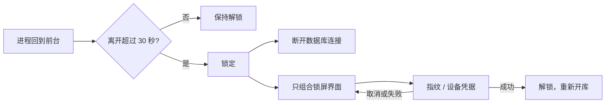

# 私密笔记（private-notes）

本地优先的 Android 私密笔记应用。所有内容存放在一台设备上，数据库从创建第一页起就是 SQLCipher 密文。

当前进度：**阶段一至阶段七全部实现**（工程基础与安全存储、笔记功能、Markdown/标签/搜索、应用锁与
隐私、备份与恢复、WebDAV 与自动备份、发布与验收）。主机端 201 个测试、设备端 31 个测试全部通过；
正式包已在 API 34 设备上完成安装、覆盖升级与加密验证。细节见文末「验证结果」。

## 技术栈

| 关注点 | 选择 |
| --- | --- |
| 语言 | Kotlin 2.0.21 |
| UI | Jetpack Compose + Material 3 |
| 数据库 | Room 2.6.1 + SQLCipher（`net.zetetic:sqlcipher-android` 4.12.0） |
| 密钥 | Android Keystore（AES-256-GCM，不可导出） |
| 应用锁 | `androidx.biometric` 1.1.0（BiometricPrompt + 设备凭据兜底） |
| 构建 | AGP 8.7.3 / Gradle 8.9 / Version Catalog |
| minSdk / targetSdk | 26 / 35 |

`sqlcipher-android` 固定在 4.12.0：这是仍依赖 `androidx.sqlite:2.2.0` 的最新版本，与 Room 2.6.1 的
组合风险最小。更高版本会带入 `androidx.sqlite` 2.6+/2.7+，属于方案 §2 明确要避免的随意升级。

## 加密模型

```
Android Keystore（不可导出 AES-256-GCM 密钥）
        │ 包裹
        ▼
32 字节随机口令 ──只以密文形式存于 SharedPreferences──► 应用私有目录
        │ 作为 SQLCipher 口令
        ▼
private_notes.db（密文）
```

代码强制的规则，不靠约定：

1. **唯一开库入口。** `EncryptedDatabaseProvider` 是构造 `AppDatabase` 的唯一地方，SQLCipher 的
   `SupportOpenHelperFactory` 在 Room 创建任何东西之前挂上，不存在明文的中间态。
2. **明文一律拒绝，不做迁移。** 开库前检查文件头，发现 `SQLite format 3\0` 直接抛异常。
3. **开库后复查。** Room 打开后重新读磁盘文件头，必须不是明文。
4. **密钥先证明可持久化，再交给数据库。** 生成 → 包裹 → 写入 → 读回 → 解包比对，全部通过才返回。
   否则写盘静默失败会造出一个永远打不开的库。
5. **密钥丢失不清库。** 库文件存在但密钥不可用时抛 `KeyUnavailable` 并提示通过备份恢复；
   不新建密钥、不删除、不重建原文件（§6.1）。
6. **备份带不走东西。** 自动备份与设备迁移排除数据库目录和持有包裹密钥的 SharedPreferences。

## 应用锁与隐私



1. **只有认证能解锁。** 状态机初始即锁定（冷启动、进程被杀后重来都一样），唯一的出口是
   `AppLockManager.unlock()`。
2. **30 秒宽限。** 超过 30 秒才要求重新认证；刚好 30 秒返回不算。计时挂在
   `ProcessLifecycleOwner` 上，旋转屏幕、弹对话框不会误判为离开。
3. **系统界面不算离开。** 指纹弹窗、设备凭据页、文件选择器用 `beginSystemUi`／`endSystemUi`
   括起来；系统界面没回调时，下一次回到前台会清掉标记，不会永久免锁。
4. **锁定时不组合笔记界面。** `AppLockGate` 在锁定时只渲染锁屏，导航图与 ViewModel 一并销毁，
   不存在「先显示再遮挡」的中间帧。
5. **锁定时关库。** 锁定即断开 Room 连接，解锁后重新打开同一个密文库；不重建、不清空。
6. **截图与最近任务预览。** `FLAG_SECURE` 无条件设置在窗口上，锁屏界面也包含在内。
7. **没有锁屏凭据就不开锁。** 设备未设置 PIN/图案/密码时拒绝开启应用锁，并引导去系统安全设置，
   避免出现「锁得上、解不开」。

## 目录

```
app/src/main/java/com/example/privatenotes/
├── security/         Keystore 包裹、密钥管理、明文库防护、应用锁、FLAG_SECURE
├── data/local/       AppDatabase、实体、DAO、加密开库入口、migrations
├── data/repository/  NoteRepository、TagRepository、TimeSource、LIKE 转义
├── feature/notes/    列表（搜索 + 标签筛选）、编辑器（自动保存、预览、标签）
├── feature/trash/    回收站、恢复、永久删除
├── feature/lock/     锁屏界面、应用锁开关
├── ui/markdown/      单换行规则、Markwon 渲染
├── ui/components/    标签标签行、标签筛选行
├── ui/               AppRoot（锁门）、navigation、theme（暖纸配色）
```

## Markdown、标签与搜索

1. **单换行就是换行。** `MarkdownLineBreaks` 在渲染前显式给「下一行还有正文」的行补 CommonMark
   硬换行，跳过围栏代码块、空行和已有换行。不依赖渲染器默认行为（§7.2）。
2. **预览不碰原文。** 编辑器存的始终是 Markdown 源文本，预览只是渲染结果；切换视图共用
   ViewModel 里同一个字符串，光标由界面持有，所以不丢内容也不丢未提交输入。
3. **只做必要语法。** Markwon + CommonMark，覆盖标题、列表、引用、代码块、链接、分隔线，
   不引入网页渲染环境。
4. **标签按稳定 ID 关联。** 名字大小写不敏感比较，「Work」与「work」归一为同一个标签；改名撞上
   已有名字时在事务里合并两个标签并保留笔记关联。
5. **一条语句服务三种用法。** 列表、搜索、标签筛选共用同一条参数化查询：关键词包含式匹配标题或
   正文，标签用 EXISTS 子查询（多标签笔记不会重复出现），两者可组合；用户输入里的 `%` `_` `\`
   先转义再绑定，不拼接 SQL。

## 数据模型（schema v1）

| 表 | 说明 |
| --- | --- |
| `notes` | UUID 主键、标题、Markdown 正文、createdAt / updatedAt / deletedAt |
| `tags` | UUID 主键、名称（NOCASE 唯一）、createdAt / updatedAt |
| `note_tag_refs` | 以稳定 ID 关联笔记与标签 |
| `deletion_markers` | 永久删除的墓碑，阻止旧备份复活已删笔记 |

时间戳统一为 **UTC epoch 毫秒**。方案 §5.1 只写了「Unix 时间戳」，这里选毫秒：§9.5 依赖比较
`updatedAt` 决定导入冲突归属，秒级精度下同一秒内的两次编辑无法区分。

schema 由 Room 导出到 `app/schemas/`。迁移必须逐版本写在 `data/local/migrations`，没有
destructive fallback。

## 备份与恢复（阶段五）

备份使用独立的 `private-notes-backup` 格式，`schemaVersion` 与数据库版本分开管理。文件包含笔记（含
回收站）、标签、标签关联和永久删除标记。

- 手动备份可选择密码加密。加密文件是 `PNBKP001` 二进制信封：PBKDF2-HMAC-SHA256（210,000 次）
  派生 256 位密钥，AES-256-GCM 加密，头部作为 AAD 认证；错误密码和篡改文件都会在写入数据库前被
  拒绝。
- 不加密时写出明文 JSON，界面会明确提示文件可被任何拿到它的人读取。
- 自动备份不接收密码，因此始终是明文 JSON；需要加密时使用「立即备份」或「立即上传」。
- 本地备份通过 SAF 持久化目录授权写入，文件名带 UTC 时间戳和随机后缀；写入后按 SHA-256 读回
  校验，保留最近 30 份。
- 导入先完整解密、解析和校验，再在本地目录可用时创建安全备份（导入加密备份时，安全备份用同一
  密码加密），最后在一个 Room 事务里合并。任何一步失败都不会留下半导入状态。
- 合并规则：较新的 `updatedAt` 胜出；同时间戳不同内容保留本地并记录冲突；删除标记阻止旧备份复活；
  标签按稳定 ID 合并，同名不同 ID 自动重映射；关联只在两端都存在时写入。

## WebDAV 与自动备份（阶段六）

- 只接受 HTTPS，使用系统证书校验，禁用重定向；用户名/密码使用 Basic Auth（UTF-8）。WebDAV 密码
  用 Android Keystore 包裹后存入 SharedPreferences，备份密码从不保存。
- 上传使用唯一文件名，PUT 成功后 GET 读回并比较 SHA-256；服务器拒绝 GET 时退化为 PROPFIND 长度
  校验。校验失败只删除刚上传的该文件，不触碰其他远端文件。
- 本地与远端各自使用独立的 WorkManager 周期任务（24 小时，1 小时 flex），并有独立的一次性补备份
  任务；远端任务要求网络连接。
- App 启动和回到前台时检查是否超过一天未成功，必要时安排补备份；失败按可重试性决定 WorkManager
  重试或等待下一次前台检查。
- 本地与远端状态、最近成功时间和最近失败原因分开记录；成功时间只在写入和完整性校验都完成后更新。

## 构建与测试

```bash
./gradlew assembleDebug               # 构建
./gradlew testDebugUnitTest           # 主机端：密钥、DAO、自动保存、标签、Markdown 规则、应用锁
./gradlew connectedDebugAndroidTest   # 设备端：真 SQLCipher、真 Keystore、锁屏与 FLAG_SECURE
```

加密结论只能在设备上验证：写盘字节由 SQLCipher 原生库产生。应用锁同理——`BiometricPrompt` 是系统
界面，自动化只能验证状态机与它两侧的行为，真的指纹/PIN 交互需要人工确认。

## 验证结果

主机端 201 个测试（`./gradlew testDebugUnitTest`），设备端 31 个（`connectedDebugAndroidTest`，
API 34 模拟器），全部通过；`lint` 无问题。

| 阶段 | 主机端 | 设备端 | 关键结论 |
| --- | --- | --- | --- |
| 一 工程与加密 | 27 | 11 | 库文件首字节为随机盐，全文搜不到 `SQLite format 3`；密钥丢失不清库 |
| 二 笔记功能 | 41 | 5 | 防抖自动保存、旧保存不覆盖新内容、杀进程后数据仍在 |
| 三 Markdown/标签/搜索 | 43 | — | 单换行符合博客规则；`%`、`_` 等 LIKE 字符不会造成异常 |
| 四 应用锁 | 27 | 11 | 锁定后只组合锁屏、断开数据库；FLAG_SECURE 生效；API 26–29 也能出提示 |
| 五 备份恢复 | 74 | 3 | 明文/加密往返、错误密码与损坏文件被拒、合并规则、导入回滚 |
| 六 WebDAV | 26 | 1 | 断网归类为网络失败、上传后校验、状态不误报成功 |
| 七 发布 | — | 4（升级链路） | 同签名 `1.0.0 → 1.0.1` 覆盖安装成功，笔记与标签原样保留 |

阶段七的设备端验收是手工执行的，不是自动化测试：

1. 用发布密钥构建 `1.0.0`（versionCode 1）并安装，新建笔记「Release / SurvivesUpgrade」。
2. 构建 `1.0.1`（versionCode 2），`adb install -r` 覆盖安装，`firstInstallTime` 保持首次安装时间。
3. 打开应用，笔记仍在列表中；`private_notes.db` 头 16 字节与升级前一致且仍是随机盐。
4. release APK 只含 **arm64-v8a** 的 `libsqlcipher.so`（`-PabiSet=all` 可构建四 ABI 通用包），
   `apksigner` 校验 v2 签名有效。

未验证项写在「已知限制」里，不当作已通过。

## 已知限制

- Keystore 条目被销毁（恢复出厂、部分锁屏凭据变更、数据迁到新设备）后，包裹密钥不可恢复，
  现有数据库无法打开。当前以错误状态呈现，不做自动重建；可通过备份文件在新安装上恢复。
- 应用锁只保护正常使用路径：已取得设备控制权（Root、调试、注入）的一方可以绕过任何应用内界面锁，
  方案 §6.2 对此有说明。数据库加密与界面锁是两道独立的防线。
- 设备凭据被删除后，应用锁会停在「先设置锁屏密码」页面：按方案 §6.2 不做绕过，需要重新设置凭据
  才能进入。这是有意的取舍，避免把「删除锁屏密码」变成绕过应用锁的方法。
- 应用锁开关目前在笔记列表的更多菜单里；完整设置页属于阶段六，届时迁移过去。
- 笔记列表的标签筛选使用全部标签，暂不支持重命名/删除标签的界面入口；`TagRepository` 已具备这些
  能力，界面留待设置页（阶段六）一并提供。
- 搜索为包含式匹配，不做分词（§7.3 明确 v1 不引入中文分词）。
